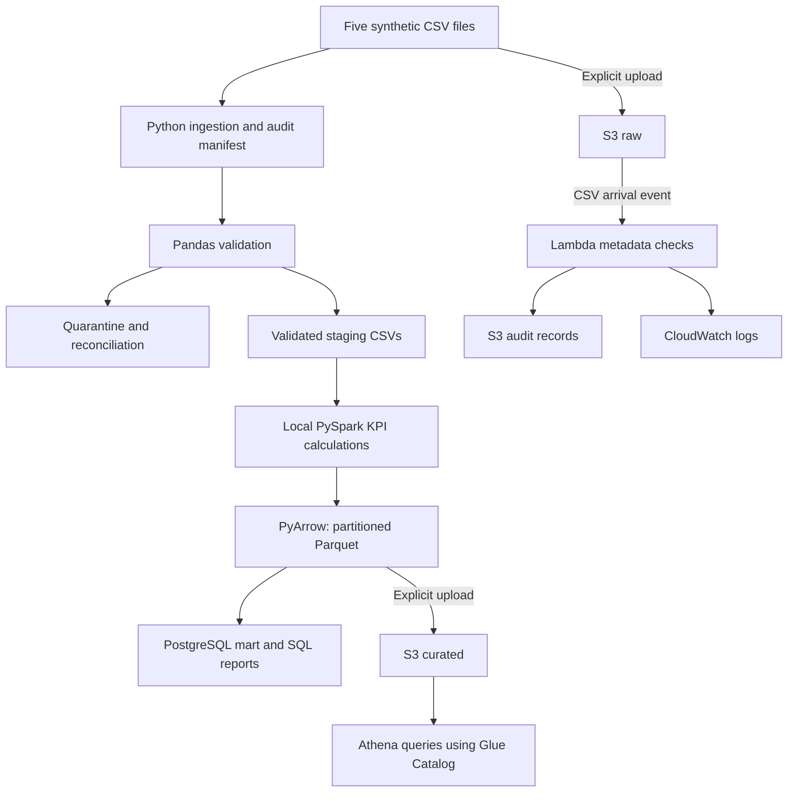

# Real-Estate Data Engineering Project

## Project overview

This project builds a reproducible analytics pipeline for the fictional
MetroSpace Property Group.

It combines property, unit, lease, maintenance, and energy records into
monthly property-level KPIs for January–June 2026.

All source records are synthetic.

## Architecture

The local processing flow is:

CSV files → Python ingestion → Pandas validation and quarantine →
PySpark KPI calculations → partitioned Parquet → PostgreSQL analytics.

The AWS analytics flow is:

Explicit upload of curated Parquet → S3 curated zone →
Glue Data Catalog → Athena.

The AWS arrival-audit flow is:

Upload to S3 raw zone → S3 notification → Lambda metadata checks →
S3 audit record and CloudWatch logs.

Spark runs locally through the VS Code notebook. Lambda performs
lightweight arrival checks; it does not run Spark or update PostgreSQL.

## Tools and environment

- Windows and VS Code
- Jupyter notebook with a dedicated virtual environment
- Python 3.12.10
- Pandas and NumPy
- PySpark 4.0.2 and Java 21
- PyArrow
- PostgreSQL 17 and psycopg
- AWS S3, Lambda, IAM, CloudWatch, Glue Data Catalog, and Athena

Exact installed Python package versions are recorded in requirements.txt.

## Project structure

- capstone.ipynb: readable end-to-end workflow
- src/ingest.py: source ingestion and audit manifest
- src/quality.py: reusable quality functions
- src/load_postgres.py: transactional PostgreSQL upsert loader
- data/raw/: unchanged synthetic CSV inputs
- data/staging/: validated CSVs grouped by run ID
- data/quarantine/: rejected source records and reasons
- data/curated/: KPI Parquet and audit outputs
- sql/01_schema.sql: dimensions, fact table, constraints, and indexes
- sql/03_analytics.sql: five analytical queries and dashboard view
- aws/lambda_handler.py: raw-arrival audit handler
- aws/sample_s3_event.json: repeatable Lambda test event
- aws/athena_ddl.sql: external table and partition registration
- aws/athena_queries.sql: occupancy and energy queries
- evidence/: screenshots and downloaded execution results

## Local setup

Create a Python 3.12 virtual environment from the project folder:

```bat
py -3.12 -m venv venv
venv\Scripts\activate
python -m pip install -r requirements.txt
```

Install the Python and Jupyter extensions in VS Code and select this
environment as the notebook kernel.

A compatible Java installation and a running PostgreSQL instance are
also required.

## Execution order

1. Run the synthetic-data generator when setting up a new project copy.
2. Run ingestion and its verification cells.
3. Run profiling, validation, quarantine, and quality tests.
4. Save staging data and reconciliation reports.
5. Start Spark and read the staging CSVs with explicit schemas.
6. Calculate occupancy, rent, maintenance, and energy KPIs.
7. Export the final dataset as partitioned Parquet.
8. Create the PostgreSQL database and execute sql/01_schema.sql.
9. Run the PostgreSQL loader and repeated-load verification.
10. Execute sql/03_analytics.sql.
11. Deploy the AWS arrival-audit function and configure its S3 trigger.
12. Upload raw inputs and explicitly upload curated Parquet.
13. Create the Athena table, register partitions, and run the queries.

When restarting the notebook kernel, rerun from ingestion onward to
recreate variables. Existing raw files do not need regeneration.

## Source data and ingestion

The five input files contain:

| Dataset | Input rows |
|---|---:|
| Properties | 12 |
| Units | 241 |
| Leases | 198 |
| Work orders | 1,501 |
| Meter readings | 1,440 |

Ingestion checks file existence, required columns, and nonempty inputs.

Values are initially loaded as strings. Each source receives a manifest
entry containing its filename, row count, UTC ingestion timestamp,
and SHA-256 digest.

Raw files are not modified during ingestion or cleaning.

## Quality decisions

- Exact duplicates: retain the first occurrence and quarantine later copies.
- Conflicting identifiers: quarantine every affected record.
- Invalid foreign keys: quarantine.
- Missing required or invalid numbers: quarantine.
- Negative rent, maintenance costs, or energy: quarantine.
- Non-positive floor areas and invalid active flags: quarantine.
- Invalid dates, chronology, priorities, or statuses: quarantine.
- Missing lease end dates: retain as ongoing leases.
- Open orders without closing dates or response durations: retain.
- Resolved orders without response durations: retain and flag;
  exclude from the SLA-eligible denominator.
- Duplicate unit-month readings: quarantine all ambiguous records.
- Overlapping leases: flag; stop KPI calculation if multiple leases
  are active for the same unit at a reporting month end.

The generated data contains no resolved orders with missing responses.
That edge case was tested using a separate synthetic record.

Quarantine outputs preserve original source values, reason codes,
and the run ID.

## Quality reconciliation

| Dataset | Input | Accepted | Quarantined |
|---|---:|---:|---:|
| Properties | 12 | 12 | 0 |
| Units | 241 | 240 | 1 |
| Leases | 198 | 198 | 0 |
| Work orders | 1,501 | 1,498 | 3 |
| Meter readings | 1,440 | 1,438 | 2 |
| Total | 3,392 | 3,386 | 6 |

Duplicate rows are included in the quarantined totals.

## KPI definitions

The reporting grain is one property per month:
12 properties × 6 months = 72 rows.

### Occupancy

Occupied active units at month end divided by total active units.

A lease is active when its start date is on or before month end and
its end date is missing or on or after month end.

### Contractual rent

Sum of monthly contractual rent for leases active at month end.

This is an analytical proxy, not cash collected, prorated rent,
or accounting revenue.

### Maintenance SLA

Compliant eligible resolved orders divided by eligible resolved orders.

Targets:
- CRITICAL: 4 hours
- HIGH: 12 hours
- MEDIUM: 48 hours
- LOW: 72 hours

Orders are grouped by opened month using source-extract status.
This is an opened-month cohort analysis, not a historical backlog snapshot.

Open orders and resolved orders missing response durations are reported
separately and excluded from the SLA denominator.

### Energy intensity

Valid monthly kWh divided by the floor area of all active units,
including vacant units.

Reading coverage is reported separately. P001 has 19 of 20 valid readings
in May and June, so its coverage is 95% in those months.

Unknown consumption is not filled with zero. Intensity for incomplete
months uses available consumption and is flagged by coverage.

Undefined rates remain NULL when their denominator is zero.

## Spark processing and Parquet workaround

Occupancy/rent, maintenance, and energy are aggregated independently
before joining on property_id and month. This avoids multiplying rent
through detailed fact-table joins.

The local Spark Parquet writer failed because Hadoop Windows support
was not configured.

As a documented workaround, only the final 72-row Spark aggregate was
collected to pandas and written with PyArrow. Raw fact tables were not
collected for KPI processing.

Output is partitioned by month. Saved values were read back and compared
with the Spark-derived export.

A native Spark Parquet write remains a portability check to complete
in a compatible environment if required by the assessor.

## PostgreSQL mart

Database: proptech360

Tables:
- dim_property
- dim_month
- fact_property_month

The fact primary key is (property_id, month).

Foreign keys and checks enforce valid relationships, counts, and ranges.
Rate columns are generated from the stored numerators and denominators.

The loader uses parameterized upserts inside a transaction. Two
consecutive loads retained 12 properties, 6 months, and 72 fact rows.

Passwords are requested privately and are not stored in source code.

## AWS configuration

Region: eu-north-1 — Europe (Stockholm)

Bucket: proptech360

Prefixes:
- raw/
- curated/property_month_kpis/
- audit/raw-arrivals/
- athena-results/

Lambda: proptech360-raw-audit

Environment variables:
- RAW_BUCKET=proptech360
- AUDIT_BUCKET=proptech360

S3 trigger:
- Object-created events
- Prefix: raw/
- Suffix: .csv

The execution role has scoped GetObject permission for raw/* and
PutObject permission for audit/*, plus logging permissions.

The handler checks arrival metadata, not CSV business contents.

It uses a deterministic audit key based on bucket, object key,
event ETag, and sequencer. Replaying the same event reused the existing
audit object without increasing the audit-object count.

Audit writes do not match the raw CSV trigger.

The handler is designed for the versioning-disabled learning bucket.
If the current object's ETag differs from the event, the arrival is
marked SUPERSEDED rather than treated as the original object.

## Athena and Glue

An external Parquet table was registered in the Glue Data Catalog
through Athena DDL, without a crawler.

Database: proptech360
Table: property_month_kpis

Six month partitions were registered. Each contains twelve property rows.

## Cross-platform reconciliation

Monthly energy totals match Spark, PostgreSQL, and Athena exactly:

| Month | Energy kWh |
|---|---:|
| January 2026 | 160,098.66 |
| February 2026 | 169,242.08 |
| March 2026 | 166,593.93 |
| April 2026 | 165,089.40 |
| May 2026 | 167,188.95 |
| June 2026 | 161,039.67 |

All six Athena reconciliation results returned PASS with zero difference.

## Rerun behaviour

- Ingestion replaces the manifest rather than appending duplicate entries.
- Quality outputs are separated by run ID.
- The Parquet export replaces the six reporting partitions.
- PostgreSQL upserts existing property-month keys.
- Duplicate S3 notifications reuse the same audit-object key.

The Parquet replacement method assumes the fixed January–June window.
It does not automatically remove unrelated historical partitions.

## Operational limitations

- Local Spark execution is not automatically triggered by S3 uploads.
- Curated files are explicitly uploaded after local processing.
- S3 uploads do not automatically refresh PostgreSQL.
- Lambda metadata acceptance does not prove CSV content quality.
- Lambda may receive duplicate or delayed events.
- Operational exceptions are logged and raised for retry.
- A production design should add failure destinations, alerts,
  automated orchestration, and stronger deployment controls.

## Costs and cleanup

Relevant costs include S3 storage and requests, Lambda execution,
CloudWatch logs, Athena queries, and Glue catalog usage.

Actual charges should be recorded from the account's billing tools.
A budget alert does not impose a spending cap.

After assessment and after downloading all evidence:

1. Remove the project's S3 event notification.
2. Delete the project Lambda function.
3. Delete its dedicated IAM role and policies if no longer used.
4. Remove the project's Glue table and database if no longer needed.
5. Delete the dedicated CloudWatch log group.
6. Empty and delete the project bucket when its contents are no longer needed.
7. Check billing for remaining project resources.

Preserve local code, data, results, and evidence before cleanup.



